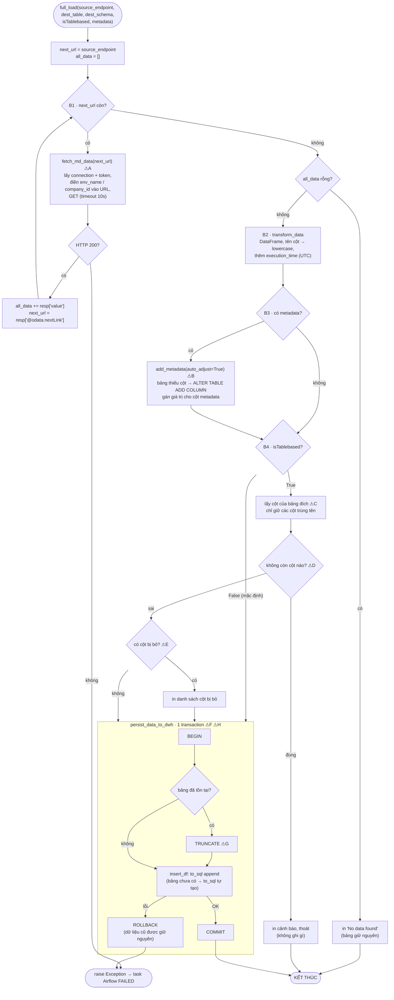

### Luồng xử lý `full_load`

`full_load` ([load_data.py](scripts/services/load_data.py))

#### Sơ đồ

#### Giải thích từng bước

**Tham số**

| Tham số | Ý nghĩa |
|---|---|
| `source_endpoint` | URL API. Có thể chứa `{env_name}`, `{company_id}`, `{company_name}`; giá trị thật được lấy từ Airflow connection `ingestion_conn`. |
| `dest_table`, `dest_schema` | Bảng đích trong DWH. |
| `isTablebased` | `False` (mặc định): ghi tất cả cột lấy từ API. `True`: chỉ ghi những cột bảng đích đã có sẵn. |
| `metadata` | Danh sách tên cột metadata cần gắn thêm vào mỗi dòng. Hiện hỗ trợ `last_refresh_at`, `company_name`, `company_id`. |

**B1: Kéo dữ liệu theo trang**

API OData không trả hết dữ liệu trong một lần mà chia thành nhiều trang. Mỗi trang có:
- `value`: các dòng dữ liệu của trang đó;
- `@odata.nextLink`: URL của trang kế tiếp. Trường này không có ở trang cuối.

Vòng `while` gọi `fetch_md_data` cho từng trang và gom các dòng vào `all_data`. Nếu API trả về mã khác `200`, hàm ném lỗi và task thất bại ngay. Lúc này chưa có gì được ghi vào DWH.

Nếu tất cả các trang đều không có dữ liệu, hàm dừng ở đây và **không truncate bảng**. Điều này tránh trường hợp API trả rỗng do sự cố làm mất dữ liệu cũ.

**B2: Chuyển thành DataFrame**

`transform_data`:
- chuyển list dict thành `DataFrame`;
- đổi toàn bộ tên cột sang chữ thường, vì Postgres phân biệt hoa thường khi tên cột được đặt trong ngoặc kép;
- thêm cột `execution_time`, ghi thời điểm chạy theo giờ UTC.

**B3: Gắn metadata (tùy chọn)**

`add_metadata` gắn thêm các cột không có trong dữ liệu API:

| Cột | Giá trị |
|---|---|
| `last_refresh_at` | thời điểm chạy |
| `company_name`, `company_id` | lấy từ connection `ingestion_conn` |

Hàm được gọi với `auto_adjust=True`. Vì vậy, nếu bảng đích đã tồn tại nhưng thiếu cột metadata, hàm tự chạy `ALTER TABLE ... ADD COLUMN` để thêm cột. Các lệnh ALTER này chạy trong transaction riêng và được commit ngay, nên cột mới vẫn còn dù bước ghi sau đó thất bại.

**B4: Ghi vào DWH**

- **`isTablebased=False`**: ghi nguyên DataFrame. Nếu API có field mới mà bảng chưa có cột tương ứng, `to_sql` sẽ báo lỗi.
- **`isTablebased=True`**: đọc danh sách cột của bảng đích và bỏ những cột không có trong bảng. Cách này giữ cấu trúc bảng cố định, nên API thêm field cũng không làm hỏng pipeline. Lưu ý rằng chế độ này **không tự thêm cột**; chỉ các cột metadata ở B3 mới được tự thêm.

`persist_data_to_dwh` chạy truncate và insert trong **cùng một transaction**:
- thành công: COMMIT, bảng chứa đúng dữ liệu mới;
- lỗi ở bất kỳ bước nào: ROLLBACK, bảng giữ nguyên dữ liệu cũ (Postgres hỗ trợ rollback TRUNCATE).

Dùng TRUNCATE thay vì `if_exists="replace"` giúp giữ nguyên cấu trúc bảng: kiểu cột, khóa chính, index và quyền.

#### Lỗi còn tồn tại

| Mã | Vị trí | Lỗi | Cách sửa |
|---|---|---|---|
| A | [ingestion.py:11](scripts/utils/ingestion.py#L11) | Ghi cache token ra `secrets/bc_token_cache.json`. Thư mục này không tồn tại trong container nên báo `FileNotFoundError`; ngoài ra token bị lưu dạng plaintext. | Bỏ cache file, dùng cache trong bộ nhớ của MSAL. |
| B | [db_utils.py:12](scripts/utils/db_utils.py#L12) | `from utils.ingestion import ...` sai đường dẫn, nên import `db_utils` sẽ lỗi và **mọi bước** đều không chạy được. | `from scripts.utils.ingestion import get_ingestion` |
| C | [load_data.py:111](scripts/services/load_data.py#L111) | Truyền `Engine` vào `get_existing_columns`, nhưng trong SQLAlchemy 2.0 `Engine` không có `.execute()`. | Mở `with establish_wh_connection().connect() as conn:` rồi truyền `conn`. |
| D | [load_data.py:112-115](scripts/services/load_data.py#L112-L115) | Bảng chưa tồn tại thì danh sách cột rỗng, hàm thoát và không bao giờ tạo được bảng. | Nếu `table_columns` rỗng thì bỏ qua bước lọc và ghi nguyên `df`. |
| E | [load_data.py:116](scripts/services/load_data.py#L116) | So sánh số **dòng** với số **cột**. | `len(df_filtered.columns) < len(df.columns)` |
| F | [load_data.py:108](scripts/services/load_data.py#L108), [119](scripts/services/load_data.py#L119) | Truyền `(df, dest_schema, dest_table)` trong khi hàm nhận `(df, dest_table, dest_schema)`, nên schema và table bị đảo. | Đổi thứ tự lúc gọi. |
| G | [load_data.py:54](scripts/services/load_data.py#L54) | `truncate_table(df, conn, ...)` truyền thừa `df`, nên báo `TypeError` khi bảng đã tồn tại. | `truncate_table(conn, dest_schema, dest_table)` |
| H | [db_utils.py:2](scripts/utils/db_utils.py#L2), [34-38](scripts/utils/db_utils.py#L34-L38) | `text` được import từ `email.mime` (là module, không gọi được); `os.inviron` và `os.environ(...)` sai cú pháp, nên kết nối DWH và mọi câu SQL trong `db_utils` đều lỗi. | `from sqlalchemy import text`; dùng `os.environ["DWH_HOST"]`. |

#### Đã sửa so với bản sơ đồ trước

- Key phân trang đã đổi từ `"values"` thành `"value"`.
- Request đã có Bearer token và `timeout=10`; khi lỗi thì in `response.text`.
- `add_metadata` đã nhận đủ tham số `dest_schema`, `dest_table`, `auto_adjust`.
- `persist_data_to_dwh` đã gọi `insert_df` sau bước truncate.
