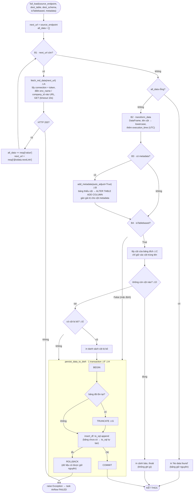
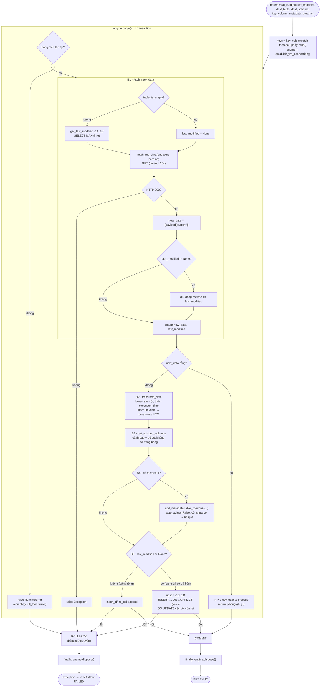

### Luồng xử lý `full_load`

`full_load` ([load_data.py](scripts/services/load_data.py))

#### Sơ đồ

#### Giải thích từng bước

**Tham số**

| Tham số | Ý nghĩa |
|---|---|
| `source_endpoint` | URL API. Có thể chứa `{env_name}`, `{company_id}`, `{company_name}`; giá trị thật được lấy từ Airflow connection `ingestion_conn`. |
| `dest_table`, `dest_schema` | Bảng đích trong DWH. |
| `isTablebased` | `False` (mặc định): ghi tất cả cột lấy từ API. `True`: chỉ ghi những cột bảng đích đã có sẵn. |
| `metadata` | Danh sách tên cột metadata cần gắn thêm vào mỗi dòng. Hiện hỗ trợ `last_refresh_at`, `company_name`, `company_id`. |

**B1: Kéo dữ liệu theo trang**

API OData không trả hết dữ liệu trong một lần mà chia thành nhiều trang. Mỗi trang có:
- `value`: các dòng dữ liệu của trang đó;
- `@odata.nextLink`: URL của trang kế tiếp. Trường này không có ở trang cuối.

Vòng `while` gọi `fetch_md_data` cho từng trang và gom các dòng vào `all_data`. Nếu API trả về mã khác `200`, hàm ném lỗi và task thất bại ngay. Lúc này chưa có gì được ghi vào DWH.

Nếu tất cả các trang đều không có dữ liệu, hàm dừng ở đây và **không truncate bảng**. Điều này tránh trường hợp API trả rỗng do sự cố làm mất dữ liệu cũ.

**B2: Chuyển thành DataFrame**

`transform_data`:
- chuyển list dict thành `DataFrame`;
- đổi toàn bộ tên cột sang chữ thường, vì Postgres phân biệt hoa thường khi tên cột được đặt trong ngoặc kép;
- thêm cột `execution_time`, ghi thời điểm chạy theo giờ UTC.

**B3: Gắn metadata (tùy chọn)**

`add_metadata` gắn thêm các cột không có trong dữ liệu API:

| Cột | Giá trị |
|---|---|
| `last_refresh_at` | thời điểm chạy |
| `company_name`, `company_id` | lấy từ connection `ingestion_conn` |

Hàm được gọi với `auto_adjust=True`. Vì vậy, nếu bảng đích đã tồn tại nhưng thiếu cột metadata, hàm tự chạy `ALTER TABLE ... ADD COLUMN` để thêm cột. Các lệnh ALTER này chạy trong transaction riêng và được commit ngay, nên cột mới vẫn còn dù bước ghi sau đó thất bại.

**B4: Ghi vào DWH**

- **`isTablebased=False`**: ghi nguyên DataFrame. Nếu API có field mới mà bảng chưa có cột tương ứng, `to_sql` sẽ báo lỗi.
- **`isTablebased=True`**: đọc danh sách cột của bảng đích và bỏ những cột không có trong bảng. Cách này giữ cấu trúc bảng cố định, nên API thêm field cũng không làm hỏng pipeline. Lưu ý rằng chế độ này **không tự thêm cột**; chỉ các cột metadata ở B3 mới được tự thêm.

`persist_data_to_dwh` chạy truncate và insert trong **cùng một transaction**:
- thành công: COMMIT, bảng chứa đúng dữ liệu mới;
- lỗi ở bất kỳ bước nào: ROLLBACK, bảng giữ nguyên dữ liệu cũ (Postgres hỗ trợ rollback TRUNCATE).

Dùng TRUNCATE thay vì `if_exists="replace"` giúp giữ nguyên cấu trúc bảng: kiểu cột, khóa chính, index và quyền.

#### Lỗi còn tồn tại

| Mã | Vị trí | Lỗi | Cách sửa |
|---|---|---|---|
| A | [ingestion.py:11](scripts/utils/ingestion.py#L11) | Ghi cache token ra `secrets/bc_token_cache.json`. Thư mục này không tồn tại trong container nên báo `FileNotFoundError`; ngoài ra token bị lưu dạng plaintext. | Bỏ cache file, dùng cache trong bộ nhớ của MSAL. |
| B | [db_utils.py:12](scripts/utils/db_utils.py#L12) | `from utils.ingestion import ...` sai đường dẫn, nên import `db_utils` sẽ lỗi và **mọi bước** đều không chạy được. | `from scripts.utils.ingestion import get_ingestion` |
| C | [load_data.py:111](scripts/services/load_data.py#L111) | Truyền `Engine` vào `get_existing_columns`, nhưng trong SQLAlchemy 2.0 `Engine` không có `.execute()`. | Mở `with establish_wh_connection().connect() as conn:` rồi truyền `conn`. |
| D | [load_data.py:112-115](scripts/services/load_data.py#L112-L115) | Bảng chưa tồn tại thì danh sách cột rỗng, hàm thoát và không bao giờ tạo được bảng. | Nếu `table_columns` rỗng thì bỏ qua bước lọc và ghi nguyên `df`. |
| E | [load_data.py:116](scripts/services/load_data.py#L116) | So sánh số **dòng** với số **cột**. | `len(df_filtered.columns) < len(df.columns)` |
| F | [load_data.py:108](scripts/services/load_data.py#L108), [119](scripts/services/load_data.py#L119) | Truyền `(df, dest_schema, dest_table)` trong khi hàm nhận `(df, dest_table, dest_schema)`, nên schema và table bị đảo. | Đổi thứ tự lúc gọi. |
| G | [load_data.py:54](scripts/services/load_data.py#L54) | `truncate_table(df, conn, ...)` truyền thừa `df`, nên báo `TypeError` khi bảng đã tồn tại. | `truncate_table(conn, dest_schema, dest_table)` |
| H | [db_utils.py:2](scripts/utils/db_utils.py#L2), [34-38](scripts/utils/db_utils.py#L34-L38) | `text` được import từ `email.mime` (là module, không gọi được); `os.inviron` và `os.environ(...)` sai cú pháp, nên kết nối DWH và mọi câu SQL trong `db_utils` đều lỗi. | `from sqlalchemy import text`; dùng `os.environ["DWH_HOST"]`. |

#### Đã sửa so với bản sơ đồ trước

- Key phân trang đã đổi từ `"values"` thành `"value"`.
- Request đã có Bearer token và `timeout=10`; khi lỗi thì in `response.text`.
- `add_metadata` đã nhận đủ tham số `dest_schema`, `dest_table`, `auto_adjust`.
- `persist_data_to_dwh` đã gọi `insert_df` sau bước truncate.

---

### Luồng xử lý `incremental_load`

`incremental_load` ([load_data.py:140](scripts/services/load_data.py#L140)), dùng kèm `fetch_new_data` ([load_data.py:106](scripts/services/load_data.py#L106)) và `upsert` ([load_data.py:124](scripts/services/load_data.py#L124))

#### Sơ đồ

#### Giải thích từng bước

**Tham số**

| Tham số | Ý nghĩa |
|---|---|
| `source_endpoint`, `params` | URL Open-Meteo và query params (lat/long, các field `current`, `timeformat=unixtime`). |
| `dest_table`, `dest_schema` | Bảng đích. Bảng phải **đã tồn tại**, tức là đã chạy `full_load` ít nhất một lần. |
| `key_column` | Cột khóa để upsert, ngăn cách bằng dấu phẩy. Hiện là `time`. |
| `metadata` | Giống `full_load`, nhưng **không tự thêm cột** vào bảng. |

**B1: Lấy dữ liệu mới (`fetch_new_data`)**

- Bảng rỗng: `last_modified = None`, lấy toàn bộ dữ liệu API trả về.
- Bảng có dữ liệu: `last_modified = MAX(time)` trong bảng. Sau khi gọi API, chỉ giữ dòng có `time >= last_modified`.
- Dùng `>=` thay vì `>` vì `current.time` của Open-Meteo được làm tròn theo khung 15 phút. Nếu chạy lại trong cùng khung đó, dòng mới nhất vẫn được giữ lại để cập nhật giá trị qua upsert.
- API trả mã khác `200` thì ném lỗi, transaction rollback, bảng không bị ảnh hưởng.

**B2: Chuyển thành DataFrame**

Giống `full_load`: lowercase tên cột, thêm `execution_time`, đổi `time` từ unixtime sang timestamp UTC để khớp kiểu cột trong bảng.

**B3: Lọc cột theo bảng đích**

Đọc danh sách cột của bảng, in cảnh báo cho các cột API có mà bảng không có, rồi bỏ các cột đó. Nhờ vậy, API thêm field mới cũng không làm hỏng pipeline.

**B4: Gắn metadata (tùy chọn)**

Gọi `add_metadata` với `table_columns` đã có sẵn và `auto_adjust=False`. Cột metadata nào bảng chưa có sẽ bị bỏ qua, không chạy ALTER TABLE.

**B5: Ghi vào DWH**

- `last_modified` có giá trị (bảng đã có dữ liệu): dùng **upsert**. Trùng `time` thì UPDATE các cột còn lại, chưa có thì INSERT. Nhờ vậy, chạy lại nhiều lần không sinh bản ghi trùng.
- `last_modified = None` (bảng rỗng): `to_sql` append thẳng.

Toàn bộ B1–B5 nằm trong **một transaction** (`engine.begin()`): thành công thì COMMIT, lỗi ở bất kỳ bước nào thì ROLLBACK. Cuối cùng, `finally` luôn gọi `engine.dispose()` để đóng pool kết nối.

**Khác biệt so với `full_load`**

| | `full_load` | `incremental_load` |
|---|---|---|
| Dữ liệu cũ | TRUNCATE rồi ghi lại | Giữ nguyên, chỉ thêm hoặc cập nhật |
| Bảng chưa tồn tại | `to_sql` tự tạo | Báo lỗi |
| Lọc dữ liệu | Không | Theo `time >= MAX(time)` |
| Cách ghi | `to_sql` | Upsert (bảng rỗng thì `to_sql`) |
| Cột metadata thiếu | Tự ALTER TABLE thêm | Bỏ qua |

#### Lỗi còn tồn tại

| Mã | Vị trí | Lỗi | Cách sửa |
|---|---|---|---|
| A | [load_data.py:18](scripts/services/load_data.py#L18) | `MAX({MODIFIED_AT_COLUMN}` thiếu dấu `)`, gây lỗi cú pháp SQL ngay khi bảng có dữ liệu. | `SELECT MAX({MODIFIED_AT_COLUMN}) FROM ...` |
| B | [load_data.py:22-23](scripts/services/load_data.py#L22-L23), [120](scripts/services/load_data.py#L120) | Hàm trả về **string** (`strftime`), nên phép so sánh `pd.Timestamp >= str` báo `TypeError`. | Trả thẳng `conn.execute(...).scalar()`, bỏ `minutes_back`, `timedelta` và `strftime`. |
| C | DB | `ON CONFLICT (time)` cần PK hoặc UNIQUE trên `time`. Bảng do `to_sql` tạo thì không có, nên upsert sẽ lỗi. | Chạy một lần: `ALTER TABLE raw.weather_hcmc ADD PRIMARY KEY (time);` |
| D | [load_data.py:126](scripts/services/load_data.py#L126), [131](scripts/services/load_data.py#L131) | Biến `table` bị gán đè từ string thành object `Table`, nên log in ra repr. Không làm hỏng dữ liệu. | Đặt tên khác, ví dụ `target = Table(...)`, `insert(target)`. |
